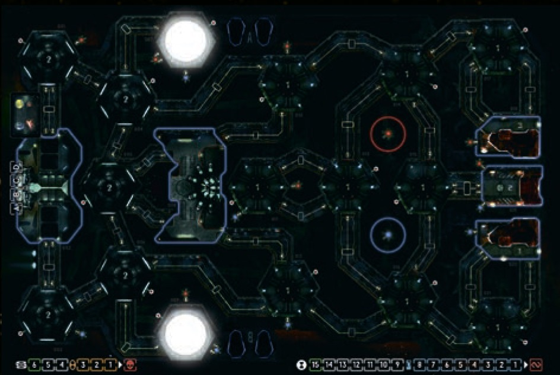

# Оригинальная Nemesis — режимы и краткие правила (стр. 27–28)

Источники: `Nemesis/Оригинальная игра/06D901C442B3F2006F116F4AAC5E536007275139_Manual10.jpg` (стр. 27) и `Nemesis/Оригинальная игра/4C6BB6B34D6A208EBD0FCC1CD177EE52B89B94A5_FIxedBookPages 1.jpg` (стр. 28). Это текст режимов и памятки из основной книги.

## Соло режим

Этот дополнительный режим игры был разблокирован в ходе краудфандинговой кампании. Хоть Nemesis и играется лучше всего как полу-кооперативная игра, вы можете попытаться выжить в одиночку.

Этот режим использует специальную колоду Целей — соло/кооп Цели. В начале игры, вместо обычных карт Целей, вытяните 2 карты из этой колоды.

Прим.: Когда происходит первый Контакт, вы должны выбрать одну из этих карт Целей.

Важно: В этом режиме количество предметов в Комнатах снижено в два раза с округлением в большую сторону (если на жетоне Исследования 1–2 предмета — установите Счетчик Предметов на 1, если 3–4 — на 2).

Для победы в игре вы должны выполнить свою цель и выжить.

## Режим полного кооператива

Этот дополнительный режим игры был разблокирован в ходе краудфандинговой кампании. Он предназначен для игроков, которые хотят опробовать полностью кооперативную версию этой игры, не боясь предательства со стороны напарников.

Этот режим использует специальную колоду Целей — соло/кооп Цели. В начале игры, вместо обычных карт Целей, каждый игрок вытягивает 2 карты из этой колоды.

Для победы в игре ВСЕ цели должны быть выполнены и хотя бы 1 Персонаж должен выжить.

Прим.: Если одна карта Цели требует отправить Сигнал, только один Персонаж должен это сделать (не обязательно тот, кому досталась эта карта). Если таких карт две или больше — такое количество Персонажей должно это сделать!

### Оживление

В этом режиме Лазарет оборудован специализированным устройством АвтоДок, позволяющим экипажу оживить человека при смерти.

Когда один из Персонажей погибает, другой Персонаж может отнести жетон Трупа этого Персонажа в исправный Лазарет. Игрок, чей Труп находится в Лазарете, помещает туда миниатюру своего Персонажа в начале раунда. Все Легкие Травмы этого Персонажа вылечены, а все Тяжелые — обработаны.

Важно: Это свойство Лазарета не работает, если в нем есть Чужой или маркер Неисправности.

## Игра за Чужого

Этот режим позволяет первому выбывшему игроку продолжить игру, взяв под контроль Чужих. Это также немного повысит сложность для оставшихся игроков. Обратите внимание, что этот режим опционален.

Игрок, чей Персонаж погибает первым, получает контроль над Чужими, заполонившими корабль и может устроить охоту за остальными игроками.

ВАЖНО: Только один игрок управляет Чужими — тот, чей Персонаж погиб первым. Если два Персонажа погибают одновременно, игрок под меньшим номером получает контроль над Чужими.

### Подготовка

Игрок, управляющий Чужими, удаляет из игры все компоненты, относящиеся к погибшему Персонажу. Затем он перетасовывает специальную колоду Действий Чужих и помещает ее перед собой.

После этого закончите текущий раунд согласно обычным правилам. Все изменения вступят в силу в начале следующей Фазы Игроков.

### Порядок раунда: фаза игроков

1. **Вытяните карты Действий:** игрок за Чужих берет 3 карты, его лимит руки — 4 карты.
2. **Жетон Первого Игрока:** игрок за Чужих пропускается на этом этапе (ему не может быть передан жетон Первого Игрока).
3. **Ходы игроков:** игрок за Чужих следует обычному порядку ходов, но в свой ход он может выполнить только 1 Действие (разыгрывая карту со своей руки) или спасовать.

Когда игрок за Чужих пасует, он может оставить на руке 1 карту и сбросить остальные.

В свой ход игрок за Чужих может разыграть карту Действия Чужих одним из следующих способов:

1. **Движение:** Переместите любого Чужого через Коридор, номер которого соответствует указанному на карте Действия Чужих. Прим.: Если Чужой перемещается в Технический коридор, следуйте обычным правилам.
2. **Атака:** Выберите любого Чужого, находящегося в одной Комнате с Персонажем. Чужой атакует этого Персонажа согласно обычным правилам, но с одним исключением: игрок за Чужих берет карты Атаки Чужих в количестве, указанном на разыгранной карте Действия Чужих. Затем он выбирает и разыгрывает 1 из них и помещает остальные под низ колоды Атак Чужих.
3. **Особый эффект:** разыграйте эффект, указанный на карте Действия Чужих.

### Фаза событий

Практически вся Фаза Событий пропускается, за исключением Счетчика Времени и Урона от Огня.

**Счетчик времени:** Согласно обычным правилам, маркеры Времени и Самоуничтожения (если процесс запущен) перемещаются на 1 поле вправо.

**Урон от огня:** Согласно обычным правилам, каждый Чужой в Комнате с маркером Пожара получает 1 Рану.

Прим.: В этом режиме остальные этапы пропускаются, в том числе:

- Чужие не проводят атак в Фазе Событий (но они по-прежнему проводят Внезапные Атаки во время Контакта, или когда Персонаж выполняет Действие «Побег» из Комнаты с Чужим);
- Карты Событий не разыгрываются, за исключением эффектов карт Действия Чужих;
- Этап Развития Улья отсутствует.

**Условие победы:** Игрок, управляющий Чужими не может полноценно выиграть в игре. Его цель — не дать другим игрокам одержать победу. В конце концов, если вы уже проиграли, сделайте так, чтобы вы не были одиноки в этом.

## Альтернативная сторона поля

Иллюстрация вырезана из скана страницы; мелкие элементы в первоисточнике не все различимы.

Эта дополнительная карта корабля была разблокирована в ходе краудфандинговой кампании. Она распечатана на обратной стороне игрового поля. Хоть это поле и было разработано специально для игры в режиме кампании, вы можете использовать его в любом игровом режиме. Однако помните, что выжить на этом поле значительно сложнее.

Одна из особенностей этого поля — это наличие двух отдельных сетей Технических Коридоров. Они работают как обычно, но они не соединены друг с другом (маркер Шума в «красных» Технических Коридорах не влияет на «синие» Технические Коридоры).

Другой особенностью является то, что некоторые Комнаты соединены между собой двумя Коридорами. Эти коридоры разделены, так что Закрытая Дверь в одном из них не влияет на другой.

Во время подготовки к игре поместите Спасательные Отсеки A и B лицевой стороной вверх на места, обозначенные на поле. Поместите жетон Исследования лицевой стороной вниз на каждый Отсек (когда Персонаж впервые входит в эти Комнаты, следуйте обычным правилам Исследования).

## Основные правила: памятка на стр. 28

### Порядок раунда

**I: Фаза игроков:**

1. Доберите до 5 карт Действий.
2. Жетон Первого Игрока передается игроку слева.
3. Ходы игроков. Все игроки по часовой стрелке: выполняют 2 Действия, ИЛИ выполняют 1 Действие и пасуют, ИЛИ пасуют. Так продолжается до тех пор, пока все игроки не спасуют. После того, как игрок пасует, он не может совершать действий в этой Фазе.

**II: Фаза событий:**

4. Переместите маркер Времени на Счетчике Времени. Переместите маркер Самоуничтожения на счетчике Самоуничтожения, если процесс запущен.
5. Атаки Чужих.
6. Урон от Огня.
7. Разыграйте 1 карту События: Движение Чужих; Эффект События.
8. Развитие Улья: вытяните 1 жетон из Пула Чужих и разыграйте его эффект.

### Ход игры и важные моменты

- **Первый контакт:** Когда первый Чужой (любого типа) появляется на поле, все игроки должны выбрать 1 Цель и сбросить другую лицевой стороной вниз.
- **Первый погибший персонаж:** После первой смерти Персонажа (любого Игрока) все Спасательные Капсулы автоматически разблокируются. Игрок, чей Персонаж умер первым, может начать играть за Чужих.
- **Счетчик времени:** Когда маркер Времени достигает любого синего поля на Счетчике Времени, камеры Анабиоза открываются.
- **Самоуничтожение:** Когда маркер Самоуничтожения достигает любого желтого поля на Счетчике Самоуничтожения, все Спасательные Капсулы автоматически разблокируются.

### Исследование

Когда вы входите в неисследованную (лежащую лицевой стороной вниз) Комнату:

1. Переверните Тайл Комнаты (лицевой стороной вверх).
2. Переверните жетон Исследования в этой Комнате и разыграйте его эффект. Некоторые эффекты могут отменить шаг 3.
3. Если в Комнате никого нет, бросьте кубик Шума.

### Действия

Вы не можете сбросить с руки карты Заражения в качестве платы за Действие.

- **Базовые действия:** Сбросьте 1 карту Действия с руки для выполнения 1 Базового Действия. Сбросьте 2 карты для выполнения Действия «Осторожное Движение».
- **Карты действий:** Сбросьте карту Действия, которое вы хотите выполнить, а также указанное на ней количество дополнительных карт в качестве платы.
- **Действия комнат:** Сбросьте 2 карты Действия с руки для выполнения Действия Комнаты. Нельзя выполнять в комнате с маркером Неисправности.
- **Действия предметов:** Сбросьте указанное количество карт Действия с руки для выполнения Действия с карты Предмета. Некоторые Предметы (Одноразовые) также должны быть сброшены после выполнения этого Действия.

### Предметы и объекты

**Предметы:** Обычные Предметы находятся в вашем Инвентаре, так что только вы знаете, что вы нашли.

**Квестовые предметы:** В начале игры эти карты являются Квестами (горизонтальная сторона), а не Предметами. Вы можете активировать их, выполнив условия Квестов.

**Тяжелые предметы:** Вы можете нести максимум 2 Тяжелых Предмета, по одному в каждом слоте Руки. Если вы хотите заменить Тяжелый Предмет, который вы несете, другим, сбросьте его не тратя Действия.

**Объекты:** Яйцо Чужих, Останки Чужих, Труп Персонажа. Необходимы для Изучения Слабостей Чужих. Они занимают слот Руки, как Тяжелый Предмет. Когда вы сбрасываете Объект, поместите его жетон в вашу Комнату.

### Бой

Вы находитесь в Бою, если в вашей Комнате есть Чужой.

**Стрельба (цена 1):** 1) Выберите Оружие и Цель. 2) Сбросьте жетон Боезапаса с выбранного Оружия. 3) Бросьте кубик Атаки. Если вы попали, поместите маркер Раны на цель, а затем вытяните карту Атаки Чужих и проверьте Результат Атаки.

**Рукопашная атака (цена 1):** 1) Вытяните 1 карту Заражения. 2) Выберите Цель. 3) Бросьте кубик Атаки (2 попадания считаются 1). Если вы попали, поместите маркер Раны на цель, а затем вытяните карту Атаки Чужих и проверьте Результат Атаки. Если вы промахнулись, Чужой наносит вам 1 Тяжелую Травму.

**Побег (особое движение, цена 1):** 1) Выберите соседнюю Комнату, в которую вы хотите уйти. 2) Вытяните карту Атаки Чужих и разыграйте ее эффект. Если вы погибли, поместите жетон Трупа Персонажа в Комнату, в которой вы были. Если вы выжили, вы перемещаетесь. Разыграйте это движение по обычным правилам (Исследуйте новую Комнату, бросьте кубик Шума и так далее).

**Атака Чужих:** 1) Выберите атакуемого Персонажа (с наименьшим количеством карт на руке). 2) Вытяните карту Атаки Чужих и разыграйте ее эффект: если какой-либо из символов Чужих на карте соответствует типу атакующего Чужого, Атака успешна. Разыграйте Эффект этой карты. Если на карте нет соответствующих символов, Атака проходит мимо.

**Символы Чужих:** Личинка, Ползун, Трутень, Охотник, Королева. Сопоставление с другой легендой на стр. 21 — в [разделе о слабостях](RULES_ORIGINAL_INFECTION_WOUNDS_RU.md).
