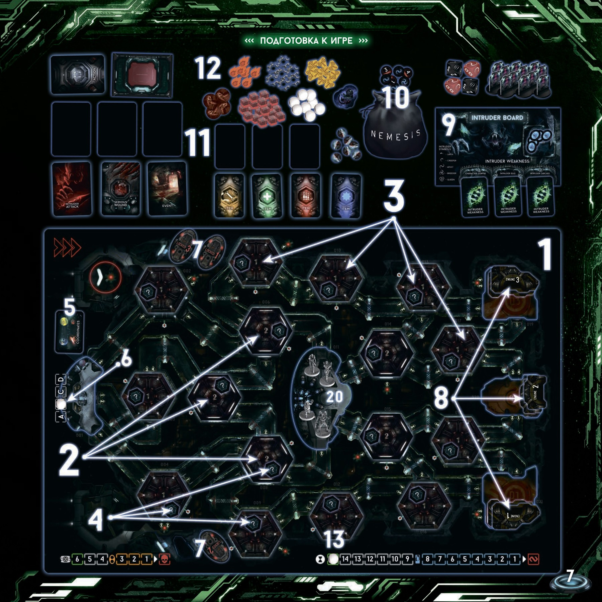
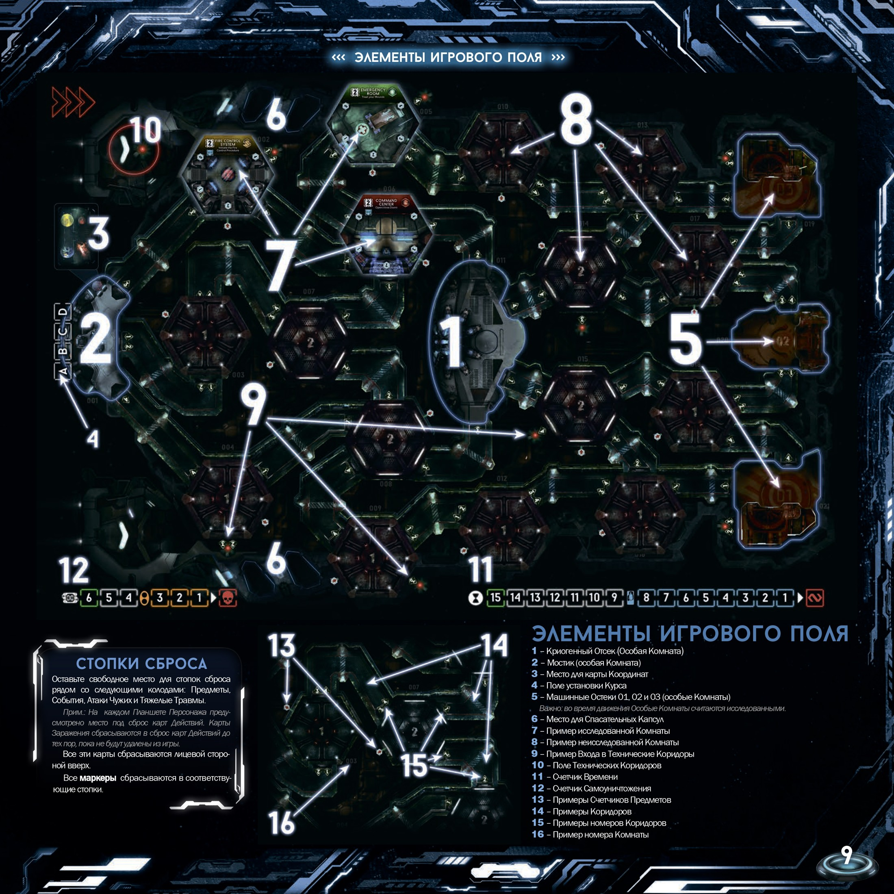

# Оригинальная Nemesis — подготовка игры и элементы поля

Ручная транскрипция текста страниц 6–9 доступных сканов. Нумерация шагов и терминология сохранены по источнику; графическая схема подготовки не заменяется этим текстом. Остальные страницы см. в [указателе базовой игры](ORIGINAL_BASE_STATUS_RU.md).

## Стр. 6–7. Подготовка к игре: шаги 1–13, подготовка поля

Источник: `Nemesis/Оригинальная игра/53B0CCE131B739CCEC55F10B9924E86CC7DB8CF6_FixedBookPages 13.jpg`.

**1)** Положите игровое поле на стол. Используйте базовую сторону, как показано на изображении.

Прим.: Базовая сторона поля отмечена красной стрелкой в верхнем левом углу.

**2)** Перемешайте все тайлы Комнат «2» (не глядя на их лицевую сторону) и случайным образом поместите (лицевой стороной вниз) по одному тайлу на каждый слот Комнаты на поле, отмеченный цифрой «2».

Уберите все оставшиеся тайлы Комнат «2» обратно в коробку.

Прим.: Вы не сможете использовать все имеющиеся тайлы Комнат «2» в каждой игре, так как их больше, чем слотов на поле. Игроки не могут знать наверняка, какие Комнаты им встретятся на корабле.

Прим.: Когда вы убираете какие-либо компоненты обратно в коробку, старайтесь не рассматривать их содержимое.

**3)** Далее, таким же образом поместите тайлы Комнат «1» на слоты, отмеченные цифрой «1».

**4)** Перемешайте все жетоны Исследования (не глядя на их лицевую сторону) и случайным образом поместите по одному жетону (лицевой стороной вниз) на каждый тайл Комнаты.

Уберите все оставшиеся жетоны Исследования обратно в коробку.

**5)** Случайным образом выберите одну из карт Координат и поместите её на специальное место на поле рядом с Мостиком.

Уберите все оставшиеся карты Координат обратно в коробку.

**6)** Поместите 1 маркер Состояния на слот «B» на поле установки Курса. Теперь это маркер Курса.

**7)** Возьмите следующее количество случайно выбранных жетонов Спасательных Капсул:

- 1–2 игрока: 2 Спасательных Капсулы.
- 3–4 игрока: 3 Спасательных Капсулы.
- 5 игроков: 4 Спасательных Капсулы.

Поместите Капсулу под наименьшим номером в Отсек «A», затем поместите следующую (по возрастанию) в отсек «B». Выкладывайте оставшиеся Капсулы поочередно в Отсеки «A» и «B».

Жетоны Спасательных Капсул должны выкладываться Заблокированной стороной вверх.

Уберите все оставшиеся Спасательные Капсулы обратно в коробку.

**8)** Возьмите оба жетона Двигателей, обозначенных цифрой «1» (1 Исправный и 1 Неисправный) и перемешайте их лицевой стороной вниз. Поместите их стопкой лицевой стороной вниз на соответствующий слот в Машинном Отсеке «1» на игровом поле. Верхний жетон отражает истинное состояние Двигателя.

Проделайте то же самое с жетонами Двигателей «2» и «3».

Важно: Убедитесь в том, что игроки не видели обороты жетонов, чтобы они не знали, работают Двигатели, или нет.

**9)** Возьмите Планшет Чужих, выложите его рядом с игровым полем и поместите в соответствующие ячейки:

- 5 жетонов Яиц
- 3 случайные карты Слабостей. Они выкладываются лицевой стороной вниз, так что игроки не знают, какие именно Слабости они смогут изучить в этой игре.

Уберите все оставшиеся карты Слабостей обратно в коробку.

**10)** Возьмите мешок (Пул Чужих) и поместите в него следующие жетоны Чужих: 1 Пустой, 4 Личинки, 1 Крипер, 1 Королева, 3 Взрослых Особей.

Затем добавьте по 1 жетону Взрослой Особи за каждого игрока, участвующего в игре.

Оставшиеся жетоны Чужих выложите рядом с игровым полем — они будут задействованы в ходе игры.

Также выложите рядом с полем жетоны Останков Чужих — они будут отражать убитых Чужих.

**11)** Перемешайте и поместите лицевой стороной вниз рядом с полем следующие колоды карт: Предметов 3 цветов, Событий, Атак Чужих, Заражения и Тяжелых Травм.

Поместите колоду Создаваемых предметов рядом с 3 колодами Предметов. Поместите Сканер рядом с колодой Заражения.

Уберите все карты Действий Чужих и карты Соло/Кооперативных Целей обратно в коробку — эти колоды используются только в расширенных игровых режимах — см. Игровые Режимы, стр. 27.

**12)** Поместите остальные жетоны, маркеры и кубики рядом с полем:

- Маркеры Пожара
- Маркеры Неисправности
- Маркеры Шума
- Маркеры Ран/Боезапаса
- Маркеры Состояния (используются в качестве маркеров Легких Травм/Слизи/Сигнала/Самоуничтожения/Времени/Курса)
- Жетоны Дверей
- Красные жетоны Трупов Персонажей
- 2 кубика Боя
- 2 кубика Шума
- Жетон Первого Игрока

**13)** Поместите 1 маркер Состояния на зеленое поле Счетчика Времени. Теперь это маркер Времени.

Подготовка игрового поля закончена! Теперь перейдите к подготовке экипажа, описанной на стр. 8.

### Символы Чужих на стр. 6

На иллюстрации указаны: Личинка, Ползун, Трутень, Охотник, Королева. Символы и миниатюры необходимо сопоставлять с исходным изображением. Текст шага 10 использует также названия «Крипер» и «Взрослая Особь»; автоматическая замена названий не сделана.

### Стр. 7 — схема расстановки

Схема — уменьшенная копия правой страницы исходного разворота, а не новая игровая карта. Для мелких деталей используйте оригинальный скан.

На схеме изображена базовая сторона корабля с красными стрелками в верхнем левом углу. Стрелки и номера указывают на примеры расстановки: **1** — игровое поле, **2** — тайлы комнат «2», **3** — тайлы комнат «1», **4** — закрытые жетоны Исследования на тайлах, **5** — карта Координат, **6** — маркер Курса, **7** — заблокированные капсулы в отсеках, **8** — жетоны трёх двигателей, **9** — планшет Чужих с яйцами и картами слабостей, **10** — мешок и жетоны Чужих, **11** — колоды и места сброса, **12** — общий запас компонентов, **13** — маркер Времени, **20** — синий труп в Криогенном Отсеке. Номера 14–19 относятся к подготовке игроков на следующей странице. Схема иллюстративная; расположение проходов и полное изображение компонентов см. в исходном скане.

## Стр. 8. Подготовка к игре: шаги 14–20, подготовка экипажа

Источник: `Nemesis/Оригинальная игра/32077E78645284FBD7FA816F2E2649114A157498_Manual14.jpg`.

**14)** Возьмите карты-Памятки в количестве, равном числу игроков и случайным образом раздайте по одной каждому игроку. Эти карты определяют порядок выбора Персонажей (шаг 17). Если в игре 3 игрока, используйте карты с номерами 1-3, если 4 — с номерами 1-4 и т.д.

Число, указанное на карте-Памятке и Инвентаре, является Номером Персонажа — он имеет значение не только при выборе Персонажа, но и для некоторых Целей.

Уберите все оставшиеся карты-Памятки обратно в коробку. Больше о Целях — см. стр. 12.

**15)** Каждый игрок получает 1 пластиковый держатель карт с тем же номером, что и их карта-Памятка. Он используется для хранения карт Предметов в тайне от других игроков в ходе игры.

Это ваш Инвентарь, место, где вы храните все ваши не-Тяжелые Предметы. Только вы знаете, что у вас есть, в то время как другие игроки могут только догадываться.

**16)** Удалите из обеих колод Целей (Корпоративных и Личных) все карты, на которых указано количество игроков, превышающее фактическое.

Перемешайте эти колоды по-отдельности и раздайте каждому игроку по 1 карте из Колоды Корпоративных Целей и по 1 из Колоды Личных Целей. Каждый игрок должен хранить содержание своих Карт Целей в тайне от других игроков!

Уберите все оставшиеся карты Целей обратно в коробку.

Когда кто-либо из Персонажей впервые встречает Чужого, все игроки должны будут выбрать, какую из своих Целей они будут пытаться выполнить в ходе игры. Больше о Первом Контакте — см. стр. 12.

Совет: Есть веская причина, по которой игроки получают свои Цели перед Драфтом Персонажей! Зная свою Цель, вы можете выбрать Персонажа, который имеет наилучшие шансы на ее выполнение.

**17)** Перемешайте все карты Драфта Персонажей. Игроки выбирают Персонажей следующим образом: Игрок 1 берет 2 случайные карты Драфта Персонажей, вскрывает обе, выбирает 1 из них и замешивает оставшуюся обратно в колоду Драфта Персонажей. Затем то же самое проделывает игрок 2, затем игрок 3 и т.д.

Игрок может управлять только тем персонажем, чью карту он выбрал на этапе Драфта.

После завершения Драфта уберите все оставшиеся карты Драфта Персонажей обратно в коробку, так как они больше не понадобятся.

**18)** Каждый игрок получает следующие компоненты:

- **A)** Планшет Персонажа, которого он выбрал на этапе Драфта.
- **B)** Миниатюру своего Персонажа и помещает её в Криогенный Отсек. Поместите миниатюру своего Персонажа в цветное пластиковое кольцо.
- **C)** Колоду карт Действий своего Персонажа, перемешивает ее и кладет слева от своего Планшета Персонажа, лицевой стороной вниз.
- **D)** Карту Стартового Предмета (Оружия) своего Персонажа и кладет её в один из двух слотов Руки на Планшете Персонажа. После этого он выкладывает на неё Маркеры Боезапаса в количестве, указанном на карте Оружия.
- **E)** 2 Квестовых Предмета своего персонажа и кладет их рядом с Планшетом Персонажа горизонтальной стороной вверх. Эти Предметы НЕ активны в начале игры, однако во время игры игроки могут выполнить мини-квесты, чтобы разблокировать их.

Уберите все оставшиеся Планшеты Персонажей обратно в коробку, так как они больше не понадобятся.

- **F)** Оставьте это место для стопки сброса Действий — сюда вы будете сбрасывать использованные карты Действий (и карты Заражения).

**19)** Игрок 1 берет Жетон Первого Игрока.

**20)** Положите Синий жетон Трупа Персонажа в Криогенный Отсек. Он представляет собой тело бедолаги, лежащего в луже крови. В ходе игры этот жетон считается Объектом «Труп Персонажа».

Синий жетон Трупа Персонажа всегда присваивается первому телу, найденному на корабле.

## Стр. 9. Элементы игрового поля и стопки сброса

### Стопки сброса

Оставьте свободное место для стопок сброса рядом со следующими колодами: Предметы, События, Атаки Чужих и Тяжелые Травмы.

Прим.: На каждом Планшете Персонажа предусмотрено место под сброс карт Действий. Карты Заражения сбрасываются в сброс карт Действий до тех пор, пока не будут удалены из игры.

Все эти карты сбрасываются лицевой стороной вверх. Все маркеры сбрасываются в соответствующие стопки.

### Элементы игрового поля

Схема — уменьшенная копия страницы исходного разворота; размещённые открытые тайлы приведены как примеры, а не как фиксированная расстановка.

1. Криогенный Отсек (Особая Комната)
2. Мостик (особая Комната)
3. Место для карты Координат
4. Поле установки Курса
5. Машинные Отсеки 01, 02 и 03 (особые Комнаты)

Важно: во время движения Особые Комнаты считаются исследованными.

6. Место для Спасательных Капсул
7. Пример исследованной Комнаты
8. Пример неисследованной Комнаты
9. Пример Входа в Технические Коридоры
10. Поле Технических Коридоров
11. Счетчик Времени
12. Счетчик Самоуничтожения
13. Примеры Счетчиков Предметов
14. Примеры Коридоров
15. Примеры номеров Коридоров
16. Пример номера Комнаты
